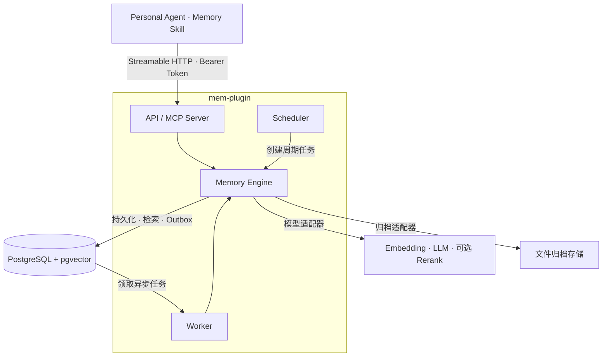

# mem-plugin

面向 Personal Agent 的独立记忆服务，提供基于 MCP Streamable HTTP 的持久化记忆接口。

系统以原子记忆为基础，结合语义关联、L0–L3 层级整合与混合检索，为 Agent 提供可追溯的历史信息。Python 服务通过 uv 在本机运行，PostgreSQL 与 pgvector 通过 Docker 部署。

[系统架构](#系统架构) · [使用指南](#使用指南)

## 系统架构

### 架构概览

系统采用分层架构，接入协议、记忆业务与基础设施实现相互分离。记忆引擎通过 Port 契约访问外部能力，依赖组装集中在 `bootstrap/`，支持通过 MCP 或 Python 应用调用。



| 层次 | 对应模块 | 职责 |
| --- | --- | --- |
| 接入层 | `interfaces/` | MCP 工具、认证、参数校验、身份上下文与健康检查 |
| 记忆核心 | `engine/` | 记忆读写、纠正与删除、检索、关联、层级整合和生命周期管理 |
| 基础设施层 | `infrastructure/` | PostgreSQL、向量索引、模型服务、Outbox、归档与观测数据存储 |
| 运行支撑 | `bootstrap/`、`config/`、`workers/`、`scheduler/`、`observability/` | 依赖组装、配置、任务执行、周期调度与 Trace / Span 上下文 |

运行时由 API、Worker 和 Scheduler 三个独立进程组成，共享同一 PostgreSQL 数据库。API 提供同步记忆接口；Worker 消费 Outbox，执行向量生成、关联与整合；Scheduler 定期提交整合及生命周期任务。`start.sh` 统一管理三个进程，数据库迁移通过独立命令执行。

### 记忆模型与处理流程

| 层级 | 记忆类型 | 内容 |
| --- | --- | --- |
| L0 | Atomic Note | 可独立理解和验证的事实、事件、计划或决策 |
| L1 | Topic Memory | 同一主题或局部事件的聚合 |
| L2 | Domain Memory | 跨主题的领域模式与稳定认识 |
| L3 | User Profile | 有持续证据支持的长期偏好、习惯与目标 |

L1–L3 为派生记忆，通过相邻层级的 DAG 保留来源；语义关联单独维护。高层记忆仅在证据满足条件时生成，并可追溯至 L0。

- **可靠写入**：原子记忆、Audit 与 Outbox 在同一事务提交，模型处理在后台执行。
- **混合检索**：向量与关键词候选通过 RRF 融合，支持时间及结构化字段过滤；向量服务不可用时可降级为关键词检索。
- **事实演进**：纠正产生新事实并保留原始记录；归档、恢复与删除使用独立操作。
- **访问隔离**：按用户、namespace 与 scope 限定访问范围；独立测试轮次使用各自的 namespace。
- **链路观测**：记录记忆操作、后台任务和模型调用的 Trace / Span，以及数据变更 Audit。

### Agent 使用协议

[Memory Skill](skills/mem-plugin/SKILL.md) 定义 Agent 的记忆使用流程：在已授权任务开始时召回背景，形成可复用结论后保存，最终结果可见后补充结果记忆。Skill 由 Agent 宿主加载，MCP 服务负责提供工具与执行记忆操作。

## 使用指南

### 运行要求

- Linux 或 WSL，具备 Bash 环境。
- Python 3.12+ 与 uv。
- Docker 与 Docker Compose。
- 用于语义检索的百炼 Embedding 凭证，以及用于关联和层级整合的百炼或 DeepSeek LLM 凭证。

以下命令均在仓库根目录执行。

### 1. 安装依赖

```bash
uv sync --locked --extra mcp --extra postgres
uv run --no-sync python scripts/init_env.py
```

初始化脚本根据 [.env.example](.env.example) 创建或补全 `.env`，生成 MCP Token、数据库密码及连接地址，并保留已有配置。

### 2. 配置服务与模型

编辑 `.env`，填写所选提供商的 API Key，并确认服务地址与模型配置。

| 配置 | 说明 |
| --- | --- |
| `MEM_PLUGIN_MCP_URL` | Agent 访问地址，默认 `http://127.0.0.1:8000/mcp` |
| `MEM_PLUGIN_MCP_TOKEN` | MCP Bearer Token，由初始化脚本生成 |
| `MEM_PLUGIN_HOST`、`MEM_PLUGIN_PORT` | 服务监听地址，默认 `127.0.0.1:8000` |
| `DATABASE_URL` | 本机 Python 进程使用的 PostgreSQL 连接地址 |
| `MEM_PLUGIN_USER_ID`、`MEM_PLUGIN_AGENT_ID` | 当前凭证绑定的用户与 Agent 身份 |
| `MEM_PLUGIN_NAMESPACES`、`MEM_PLUGIN_DOMAINS` | namespace 白名单与领域授权 |
| `EMBEDDING_BASE_URL`、`EMBEDDING_API_KEY`、`EMBEDDING_MODEL`、`EMBEDDING_DIMENSION` | 百炼向量服务配置 |
| `LLM_PROVIDER` | 选择 `deepseek` 或 `bailian` |
| `DEEPSEEK_LLM_BASE_URL`、`DEEPSEEK_LLM_API_KEY`、`DEEPSEEK_LLM_MODEL` | DeepSeek LLM 配置 |
| `BAILIAN_LLM_BASE_URL`、`BAILIAN_LLM_API_KEY`、`BAILIAN_LLM_MODEL` | 百炼 LLM 配置 |
| `RETRIEVAL_RERANK_ENABLED` | 可选重排开关；启用时填写独立的 `RERANK_*` 配置 |

Embedding、LLM 与 Rerank 分别管理凭证。模型思考模式、超时和处理预算等参数见 `.env.example`。当前向量 Schema 固定为 `qwen3.7-text-embedding-flash`、1024 维；更换向量空间需要配套迁移与重新向量化。

`.env`、`data/` 和 `dev/` 仅保留在本地，不纳入版本控制。

### 3. 启动数据库并应用迁移

```bash
docker compose --env-file .env \
  -f deploy/docker-compose.yml -f deploy/docker-compose.dev.yml \
  up -d --wait --pull never postgres

uv run --no-sync alembic upgrade head
```

数据库归属 `mem-plugin` Compose 项目，使用持久化卷，默认映射至 `127.0.0.1:55433`。部署配置固定镜像摘要并优先复用本机镜像；首次安装若无对应镜像，需先使用 `docker pull` 拉取 `deploy/docker-compose.yml` 中 `postgres.image` 指定的完整地址。

迁移必须在服务启动前单独执行。修改数据库端口时，同步调整 `DATABASE_URL`。

### 4. 启动与验证

```bash
./start.sh
```

启动器依次创建 API、Worker 和 Scheduler 进程，完成带认证的 MCP 工具发现后输出 `"status": "ready"`。

在另一个终端检查 HTTP 存活状态，并验证工具发现与只读搜索：

```bash
curl --fail http://127.0.0.1:8000/health
uv run --no-sync python examples/client.py
```

`/health` 仅表示 HTTP 进程存活。客户端示例中的搜索会按配置使用检索模型。

终端持续显示带进程角色和 Trace ID 的记忆操作及后台任务日志，日志文件默认位于 `data/runtime/`。按 Ctrl+C 停止本次启动的三个 Python 进程，数据库继续运行。完成首次初始化后，日常启动执行 `./start.sh`；升级涉及 Schema 变更时，先执行迁移。

### 5. 连接 Agent

在 Agent 的 MCP 客户端配置中填写：

| 项目 | 配置值 |
| --- | --- |
| 传输方式 | Streamable HTTP |
| 服务 URL | `.env` 中的 `MEM_PLUGIN_MCP_URL` |
| 认证请求头 | `Authorization: Bearer <MEM_PLUGIN_MCP_TOKEN 的实际值>` |
| Skill | 加载完整 `skills/mem-plugin/`，包含 `SKILL.md` 与 `references/` |

远程访问时，通过 HTTPS 地址暴露 MCP，并配置对应的服务监听或反向代理。默认回环地址适用于同机连接。

服务提供以下工具；调用参数以客户端发现的 Schema 为准：

| 工具 | 功能 |
| --- | --- |
| `memory.record` | 提交一条原子事实、事件或决策 |
| `memory.search` | 检索相关记忆与来源 |
| `memory.get` | 按 ID 获取记忆详情 |
| `memory.feedback` | 确认、否定或纠正记忆；纠正返回新记忆 ID |
| `memory.forget` | 删除指定事实及相关副本 |
| `memory.archive` | 将记忆归档 |
| `memory.restore` | 恢复已归档记忆 |

用户与 Agent 身份由服务端凭证绑定。通常省略工具参数中的 `namespace`，使用服务端默认空间。一次 `memory.record` 对应一条 Note，调用方负责区分可独立检索或纠正的事实。

### 6. 隔离测试轮次

普通启动使用 `.env` 中配置的固定空间，多次连接会访问该空间已有的记忆。需要独立对比不同测试轮次时，为每轮创建单独的运行配置：

```bash
uv run --no-sync mem-plugin-test create --name round-a
uv run --no-sync mem-plugin-test start <run_id>
```

将生成的私有 `connection.json` 中 URL 与 Token 配置给待测 Agent。不同 `run_id` 的记忆相互隔离，同一轮次重启保留记忆，无需清空数据库。
