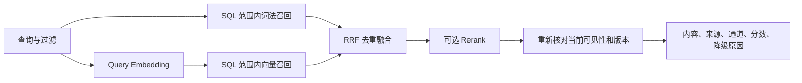

# 检索契约与实现

记忆引擎提供有界的关键词、向量及 RRF 融合检索。实现位于 Engine 的 `services/retrieval.py`；SQL 与模型 HTTP 请求分别由基础设施适配器执行。MCP 只转换参数与响应。

## 模式与数据流

| mode | 行为 | 外部请求 |
| --- | --- | --- |
| hybrid（默认） | FTS/子串/trigram 词法候选 + Query Embedding/pgvector 候选，再 RRF 融合 | 配置 Embedding Key 时调用百炼 |
| keyword | PostgreSQL FTS + 子串 + pg_trgm | 不生成 Query Embedding |
| literal | 大小写不敏感的精确子串，候选按更新时间倒序 | 不生成 Query Embedding |

三种模式都会应用身份、scope、领域、层级、类型、有效时间、发生时间与 JSONB 条件。若启用可选 Rerank，三种模式都会对候选执行重排；默认关闭。

每个通道候选预算为 `max(limit, RETRIEVAL_CANDIDATE_LIMIT)`，上限 200；结果 limit 为 1～100。RRF 按各通道排名计算 `sum(1 / (k + rank))`，不相加原始相似度。Node ID 去重，同分按 UUID 确定顺序。重排最多处理一个候选预算，未被模型返回的其他候选保留原相对顺序。

候选在 SQL 内应用 user/namespace/scope 等过滤后才 LIMIT；不会跨用户取 Top-K 再过滤。模型调用不持有数据库事务。模型调用结束后重新检查候选状态和版本，避免已删除、失效或版本变化的旧候选被返回。操作完成后的并发变更仍需调用方按需重新读取。

## 中文、精确字段与时间

FTS 使用 PostgreSQL `simple` 配置、`websearch_to_tsquery`、`ts_rank_cd` 和 GIN；它不是 BM25，也不提供中文分词。中文由转义后的字面子串和 pg_trgm 补充，词法排名依次考虑子串命中、FTS 排名、trigram 相似度和更新时间。百分号、下划线和反斜线不会变成子串通道中的通配符；keyword/hybrid 的 FTS 部分仍支持其查询语法。

`attributes`、`domain_payload` 使用 JSONB 包含匹配，适合实体、订单 ID、金额等精确条件。金额应沿用调用方既定表示，JSON 数值与字符串不同。`occurred_after/before` 是含边界的发生时间范围；未知发生时间不匹配这些条件。时间必须带时区。

`as_of` 默认当前 UTC，过滤 `valid_from <= as_of < valid_until`（空边界不限）。它只判断当前节点的有效区间，不是历史版本快照。只返回 active 节点。`get` 仍可读取可见的 stale 节点以核对历史。

真实中文小语料、结构化过滤和租户隔离已通过 PostgreSQL 集成测试；尚未完成真实模型语义效果、中文分词需求或大数据性能评测。当前保持较小候选预算，不据此声称召回率已达标。

## 降级与观测

缺少 Embedding Key 时，hybrid 返回 `mode=keyword`、`embedding_not_configured`。查询 Embedding 失败返回 `embedding_unavailable`，向量存储失败返回 `vector_unavailable`；原文仍可经关键词检索。可选重排缺少配置或失败分别记录 `rerank_not_configured`、`rerank_unavailable`，保留融合排序。词法存储本身失败明确报错，不伪装为空结果。

结果保留 `source_ids`、RRF `score`、`channels`、`channel_scores`。词法通道值为排名，向量通道值为余弦距离，重排值为模型分数；不同通道原值不可直接比较，RRF 分数也不是置信度。literal 未重排时仍以原候选顺序返回。

Trace 记录词法召回、查询向量、向量召回、融合、可选重排的独立 Span，以及候选数、模型、用量、耗时和降级原因。正文、查询、Prompt 与密钥不写入 Trace。

后台支持自动关系判断与 context 标注；当前检索不进行图扩展、层级智能路由或 LLM 查询理解。dirty 派生内容会返回标记，调用方应核对原始来源。
